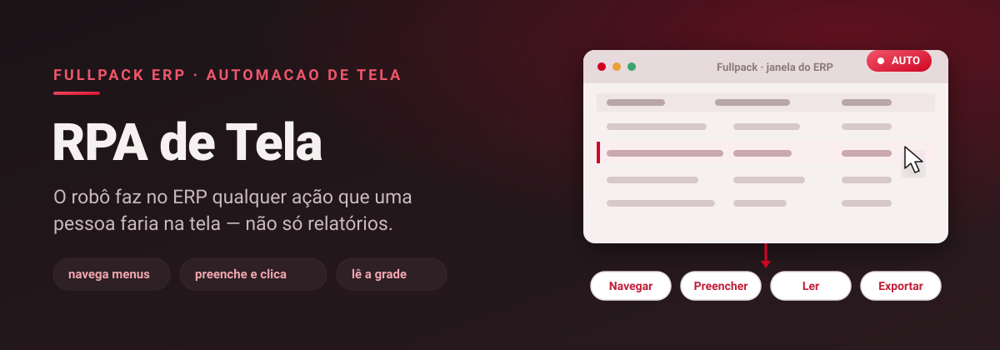
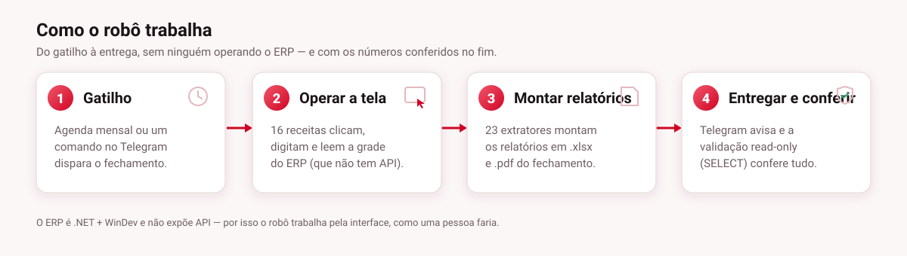

# RPA de Tela — Fullpack ERP

> Robô que **opera o ERP pela própria tela** e faz **qualquer ação que uma pessoa faria**: navega menus, preenche campos, clica, lê a grade, espera o sistema e exporta. O ERP é um aplicativo **.NET + WinDev sem API**, então em vez de integrar "por baixo", o robô trabalha **por cima** — como um operador. O fechamento mensal é só a **primeira rotina** automatizada com ele.


-D10524)


> **Esta é uma vitrine.** O código de produção, as credenciais, as coordenadas de tela e qualquer saída com dados reais ficam em repositório **privado**. Aqui mostramos só a ideia e as decisões de engenharia — nenhuma tela real do ERP, nenhum número.

---

## O problema

O ERP concentra dezenas de rotinas repetitivas — aplicar os mesmos filtros, lançar, consultar, exportar, conferir. Feito à mão, cada uma custa horas e erra quando o volume aperta. E o sistema **não tem API nem banco aberto para escrita**: é um aplicativo desktop **.NET sobre runtime WinDev**. Integrar "por baixo" não era opção.

A saída foi automatizar **por cima**: um robô que controla a interface. Tudo que um operador faz com teclado e mouse, ele faz — de forma determinística e repetível.

---

## O que o robô faz na tela

Não é um exportador de relatórios: é um **operador**. A base é automação de GUI, e com ela o robô pode:

- **Navegar** — abrir o módulo e o menu certos, trocar de aba, percorrer a árvore.
- **Preencher** — digitar em campos e formulários, marcar opções, escolher datas e filtros.
- **Clicar** — botões, confirmações, ícones de ação.
- **Ler** — a grade, os totais, as mensagens e os popups do sistema.
- **Esperar** — reconhecer "Carregando…" e só seguir quando o ERP responde (nada de tempo fixo).
- **Exportar** — mandar o ERP gerar os arquivos e organizar a saída.

Cada tela do ERP vira uma **receita** reutilizável. Montar uma rotina nova é combinar receitas — não reescrever o robô.

---

## Como funciona



O robô trabalha em ciclo — **ler → decidir → agir → conferir** — e repete para cada passo de cada tela. O mesmo ciclo vale para qualquer rotina: o que muda são as receitas que ele encadeia.

---

## Em produção hoje: o fechamento mensal

A primeira rotina montada sobre essa base é o **fechamento mensal**: o robô abre o ERP, aplica os filtros de cada relatório, exporta o pacote (`.xlsx` / `.pdf`) e, ao final, uma **validação somente‑leitura** (apenas `SELECT`) cruza os números para garantir que bate. Ele avisa cada etapa pelo **Telegram** e roda sozinho numa VM dedicada, por agenda. Nas últimas rodadas, montou e conferiu **todo o pacote** sem intervenção.

É o caso que valida a abordagem — e abre caminho para as próximas rotinas (cadastros, consultas, conferências) usando as mesmas receitas.

---

## Destaques de engenharia

**Receitas por tela, reutilizáveis.** Cada tela do ERP é uma receita versionada. Quando um update do ERP desloca um menu, conserta‑se a receita — não o robô inteiro. Rotinas novas reaproveitam o que já existe.

**Robustez de verdade.** Cada passo valida que chegou onde deveria antes de seguir; se uma tela não aparece, o robô para e avisa em vez de "clicar no escuro". Detalhes do mundo real — teclado ABNT2, popups que roubam o foco, grades que paginam — são tratados explicitamente.

**Nunca escreve sem querer.** Quando precisa conferir dados, usa uma conexão de banco **bloqueada para escrita**: qualquer `INSERT`/`UPDATE`/`DELETE` é barrado no próprio código. Leitura para comparar, nunca alteração às cegas.

**Avisa o tempo todo.** Início, progresso, conclusão e falhas vão para o Telegram, com a saída organizada por rodada — dá para acompanhar sem abrir a VM.

**Roda sozinho.** Opera numa VM dedicada, dispara por agenda e sobe o monitor automaticamente.

---

## Stack

| Camada | Tecnologia |
| --- | --- |
| Linguagem | Python 3 |
| Núcleo | Automação de GUI (tela / teclado / mouse) com *receitas* por tela |
| Alvo | Fullpack ERP — .NET sobre runtime WinDev (sem API) |
| Ações | Navegar, preencher, clicar, ler, esperar, exportar |
| Validação | Conexão de banco **somente‑leitura** (apenas `SELECT`) quando precisa conferir |
| Notificação | Telegram (início, progresso, conclusão, falhas) |
| Operação | VM dedicada, disparo por agenda, monitor automático |

---

## Estrutura (resumo)

```
rodar_fechamento.py   # orquestrador da rotina atual (o fechamento)
erp_gui.py            # engine: opera a tela (navegar, clicar, digitar, ler, esperar)
receitas_gui/         # uma receita por tela do ERP, reutilizável entre rotinas
relatorios/           # extratores da rotina de fechamento + conferência read-only
```

> As coordenadas de tela, os nomes das telas/relatórios e a saída (com dados reais) **não** estão aqui — ficam no repositório privado e no `.gitignore`.

---

## Status

Em produção no fechamento mensal, e pronto para as próximas rotinas. Código‑fonte, credenciais e saídas são **privados** — este repositório existe apenas para mostrar como o robô foi construído.

<sub>Feito pela equipe de TI da Betel Sport.</sub>
